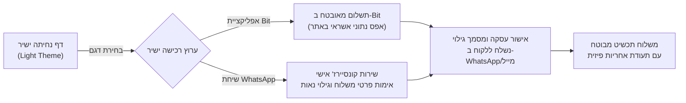
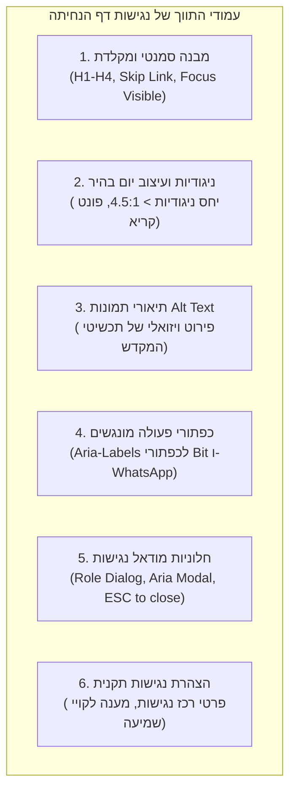

# 📜 מפרט משפטי, רגולטורי ונגישות לדף נחיתה ישיר — בוטיק "משכן לב"
## Legal, Regulatory & Accessibility Specification: Single Landing Page Direct Sales (Bit & WhatsApp)

> **תחום שיפוט:** מדינת ישראל  
> **מועד עדכון תקף:** נובמבר 2026 (כולל תיקון 13 לחוק הגנת הפרטיות ותקנות הגנת הצרכן המעודכנות)  
> **מודל מסחרי:** דף נחיתה יחיד (Single Landing Page) למכירה ישירה (Direct-to-Consumer)  
> **ערוצי רכישה וסליקה:** מעבר ישיר לאפליקציית Bit ותיאום/הזמנה ב-WhatsApp Concierge (ללא עגלת קניות מסורבלת וללא מסד נתונים מקוון)  
> **מוצרי הבוטיק:** שרשראות ותכשיטי בית המקדש וירושלים (כסף סטרלינג 925, ציפוי זהב עבה 18K/24K, זהב טהור ושיבוץ אבנים)  

---

## 🧭 תוכן עניינים
1. [תמצית מנהלים והנחות יסוד ארכיטקטוניות](#1-תמצית-מנהלים-והנחות-יסוד-ארכיטקטוניות)
2. [פרק א': ניתוח חובות חוק הגנת הצרכן (מכר מרחוק וביטולים)](#2-פרק-א-ניתוח-חובות-חוק-הגנת-הצרכן-מכר-מרחוק-וביטולים)
3. [פרק ב': ניתוח חובות הגנת פרטיות (תיקון 13) במודל ללא מסד נתונים מקוון](#3-פרק-ב-ניתוח-חובות-הגנת-פרטיות-תיקון-13-במודל-ללא-מסד-נתונים-מקוון)
4. [פרק ג': חובות נגישות (ת"י 5568 AA) מותאמות לדף נחיתה יחיד](#4-פרק-ג-חובות-נגישות-תי-5568-aa-מותאמות-לדף-נחיתה-יחיד)
5. [פרק ד': נוסחי המסמכים המשפטיים לתצוגה מהירה בפוטר (חלונית מודאל נקייה)](#5-פרק-ד-נוסחי-המסמכים-המשפטיים-לתצוגה-מהירה-בפוטר)
   - [ד.1 - תקנון ותנאי שימוש מתומצים](#ד1-תקנון-ותנאי-שימוש-מתומצים)
   - [ד.2 - מדיניות ביטול עסקה והחזרות](#ד2-מדיניות-ביטול-עסקה-והחזרות)
   - [ד.3 - תעודת אחריות תכשיטים ומדריך שמירה](#ד3-תעודת-אחריות-תכשיטים-ומדריך-שמירה)
   - [ד.4 - מדיניות פרטיות ומאגרי מידע (הודעת יידוע לפי סעיף 11)](#ד4-מדיניות-פרטיות-ומאגרי-מידע-הודעת-יידוע-לפי-סעיף-11)
   - [ד.5 - הצהרת נגישות](#ד5-הצהרת-נגישות)
6. [פרק ה': הנחיות יישום UI/UX, קישורים וטפסי פוטר](#6-פרק-ה-הנחיות-יישום-uiux-קישורים-וטפסי-פוטר)

---

## 1. תמצית מנהלים והנחות יסוד ארכיטקטוניות

דף הנחיתה של בוטיק "משכן לב" נבנה סביב תפיסת **Zero-Friction & High Trust**:
- הלקוח אינו נדרש לפתוח חשבון משתמש, אינו עובר תהליך עגלת קניות רב-שלבי, ואינו מזין פרטי אשראי רגישים בטפסים מקוונים.
- **זרימת הרכישה (Flow):** בחירת תכשיט ➔ לחיצה על "רכישה מהירה ב-Bit" או "הזמנה ישירה ב-WhatsApp" ➔ השלמת תשלום ואימות פרטי משלוח ישירות מול נציג הבוטיק.
- **היעדר מסד נתונים ברשת (No Cloud DB):** המערכת אינה מחזיקה שרת מסד נתונים ציבורי (כגון Firebase, MongoDB או SQL) עם פרטי לקוחות.

**האתגר המשפטי:** מודל מכר ישיר אינו פוטר את העוסק מהוראות החוק הקוגנטיות בישראל. להפך: הוא דורש הנגשה בהירה, מדויקת ותמציתית של הזכויות הצרכניות, הגילוי הנאות וחובות הנגישות, תוך ניצול היתרון של אפס שמירת נתוני אשראי באתר.



---

## 2. פרק א': ניתוח חובות חוק הגנת הצרכן (מכר מרחוק וביטולים)

### 2.1 סיווג העסקה כ"עסקת מכר מרחוק"
בהתאם לסעיף 14ג(ו) לחוק הגנת הצרכן, התשמ"א-1981 (להלן: "החוק"), התקשרות בעסקה לרכישת נכס כאשר ההתקשרות נעשית בלא נוכחות משותפת של הצדדים (באינטרנט, בוואטסאפ או בטלפון) מהווה **עסקת מכר מרחוק**.

### 2.2 חובת גילוי נאות לפני עשיית העסקה (סעיף 14ג(א))
בדף הנחיתה ובמהלך שיחת הוואטסאפ, חלה חובה משפטית לגלות לצרכן באופן ברור:
1. **שם העוסק, מספר זהותו/ח.פ/ע.מ וכתובתו.**
2. **התכונות העיקריות של התכשיט:** סוג המתכת (כסף סטרלינג 925, ציפוי זהב 18K/24K בעובי מיקרוני, זהב 14K), מידות התליון, אורך השרשרת, וסוג השיבוץ.
3. **מחיר העסקה ותנאי התשלום:** המחיר כולל מע"מ כחוק, עלות המשלוח בנפרד (או ציון משלוח חינם).
4. **מועד ודרך אספקת הנכס:** ציון מפורש של ימי עסקים (לדוגמה: 3–7 ימי עסקים).
5. **זכות הביטול ותנאיה:** הפניה מפורשת לזכות הביטול לפי סעיף 14ג(ג) ולמדיניות הביטולים.
6. **פרטי האחריות:** קיומה של אחריות מקיפה על פגמי ייצור וציפוי.

### 2.3 חובת מסירת מסמך גילוי בכתב לאחר כריתת העסקה (סעיף 14ג(ב))
העוסק מחויב לספק לצרכן בכתב (בהודעת WhatsApp מפורטת או בדוא"ל יחד עם החשבונית/קבלה) **מסמך גילוי פרטי עסקה** לא יאוחר ממועד הספקת התכשיט.  
המסמך יכלול את הפרטים המנויים בסעיף 14ג(ב), לרבות תנאי הביטול, דרכי פנייה לביטול ופרטי העסק.

### 2.4 זכות הביטול הסטטוטורית (14 ימים ו-4 חודשים לאוכלוסיות מיוחדות)
- **ביטול כללי:** הצרכן רשאי לבטל את העסקה מיום עשייתה ועד **14 ימים** מיום קבלת המוצר או מיום קבלת מסמך הגילוי (לפי המאוחר).
- **אוכלוסיות מיוחדות (סעיף 14ג1 לחוק):** אם הצרכן הוא **אדם עם מוגבלות, אזרח ותיק (מגיל 65 ומעלה) או עולה חדש (עד 5 שנים מעלייה)**, תקופת הביטול מוארכת ל-**4 חודשים**, ובלבד שההתקשרות בעסקה כללה שיחה (לרבות התכתבות אלקטרונית ב-WhatsApp). העוסק רשאי לדרוש תעודה המוכיחה את מעמדו.

### 2.5 דמי ביטול כדין (הבחנה חדה בין חרטה לפגם)
| עילת הביטול | שיעור דמי הביטול | עלות החזרת המשלוח | לוח זמנים להחזר |
| :--- | :--- | :--- | :--- |
| **ביטול מחמת חרטה** (ללא פגם) | עד **5% ממחיר העסקה או 100 ₪**, לפי הנמוך מביניהם (סעיף 14ה(ב)(1)). דמי המשלוח הראשוניים אינם מוחזרים. | על חשבון הלקוח ובאחריותו להחזיר את המוצר שלם באריזתו המקורית. | החזר כספי תוך 14 ימים מקבלת הודעת הביטול והמוצר. |
| **ביטול עקב פגם / אי-התאמה / אי-אספקה** | **0 ₪ דמי ביטול.** החזר מלא של כל הסכום ששולם, כולל דמי המשלוח שנגבו (סעיף 14ה(א)). | על חשבון העסק. שליח יאסוף את הפריט הפגום או שיומצא שובר גוביינא. | החזר כספי תוך 14 ימים מקבלת הודעת הביטול. |

### 2.6 סייג להזמנות בעיצוב אישי (סעיף 14ג(ד)(2))
> [!IMPORTANT]
> **הוראת הדין לגבי "טובין שיוצרו במיוחד בעבור הצרכן":**  
> זכות הביטול לפי חוק הגנת הצרכן אינה חלה על תכשיט שיוצר בהתאמה אישית מיוחדת לפי דרישת הלקוח, כגון:
> - חריטת שם, תאריך או פסוק אישי על התליון.
> - יציקה מיוחדת במידה חריגה שאינה חלק מקטלוג המדף.
> 
> **הבחנה משפטית קריטית:** תכשיטי קטלוג המוצגים בדף הנחיתה (שרשראות בית המקדש, מנורה, כותל), גם אם יוצרו בעבודת צורפות מוקפדת, **אינם נחשבים "הזמנה מיוחדת"** לצורך החרגה מחוק הגנת הצרכן! על כן, על תכשיטי הקטלוג הסטנדרטיים חלה זכות ביטול מלאה של 14 יום.

### 2.7 חובת קישור ייעודי לביטול עסקה בדף הראשי
בהתאם לתיקון לחוק הגנת הצרכן, חלה חובה על כל אתר מכר להציב בדף הבית/הנחיתה **קישור בולט שכותרתו "ביטול עסקה"**.  
לחיצה על קישור זה תפתח חלונית מהירה או טופס ישיר להגשת בקשת ביטול ללא צורך בהרשמה מקדימה או סיסמה.

---

## 3. פרק ב': ניתוח חובות הגנת פרטיות (תיקון 13) במודל ללא מסד נתונים מקוון

### 3.1 מעמד המידע במודל ישיר (ללא Online Cloud DB)
חוק הגנת הפרטיות, התשמ"א-1981 (לאחר תיקון 13 שנכנס לתוקפו) מחיל חובות רגולטוריות מהותיות על כל עסק האוסף ומעבד "מידע אישי" (Personal Data).  
גם כאשר האתר אינו מתחבר למסד נתונים בענן (MySQL/MongoDB/Firebase) ונתוני הלקוח מתקבלים ישירות ב-WhatsApp או בטלפון לצורך שילוח:
1. **המידע נחשב כמעובד ומנוהל באמצעי דיגיטלי.**
2. **ביטול חובת רישום מאגרים קטנים:** תיקון 13 ביטל את חובת הרישום הארכאית של מאגרי מידע קטנים ועסקיים שאינם כוללים מידע רגיש במיוחד. עסק בוטיק למכירת תכשיטים אינו נדרש עוד לרשום מאגר מידע ברשם מאגרי המידע.
3. **החרפת האחריות המהותית והסנקציות:** תיקון 13 העניק לרשות להגנת הפרטיות סמכויות אכיפה מנהליות ועיצומים כספיים משמעותיים על הפרת חובות יידוע, אבטחת מידע ושימוש במידע למטרות שלא הוגדרו.

### 3.2 חובת היידוע הסטטוטורית (סעיף 11 לחוק)
לפי סעיף 11, בעת פנייה לאדם לקבלת מידע עליו, חובה לציין במפורש ובאופן מודגש:
- האם חלה על האדם חובה חוקית למסור את המידע, או שמסירתו תלויה ברצונו החופשי (במקרה זה: מסירה מרצון חופשי, אך דרושה להשלמת הרכישה והשילוח).
- המטרות המדויקות שלשמן נמסר המידע (עיבוד ההזמנה, אספקה פיזית, תיאום טלפוני והפקת חשבונית מס כחוק).
- למי יימסר המידע (לחברת השילוח בלבד לצורך הגעת החבילה).
- זכויות הלקוח לעיון במידע ולתיקונו/מחיקתו לפי סעיפים 13 ו-14 לחוק.

### 3.3 עקרון צמצום המידע (Data Minimization)
דף הנחיתה הישיר מגשים את העיקרון המנחה של דיני הגנת הפרטיות: **איסוף המידע המינימלי ההכרחי בלבד**.
- **נאסף בלבד:** שם מלא, מספר טלפון סלולרי, כתובת אספקה, ובחירת תכשיט.
- **לא נאסף כלל:** מספרי תעודת זהות, פרטי כרטיסי אשראי, תאריכי לידה, נתוני מיקום שוטפים או מעקב פרסומי פולשני.

### 3.4 אפס נתוני אשראי באתר (הגנת PCI-DSS ו-Bit)
- התשלום מתבצע ישירות בתוך היישומון הרשמי של **Bit** (בבעלות בנק הפועלים) או בהעברה בנקאית ישירה.
- האתר אינו אוסף, אינו משדר ואינו מאחסן פרטי כרטיסי אשראי או קודי CVV.
- בכך האתר משוחרר כליל מעמידה בתקני PCI-DSS מורכבים ומוגן מחשיפה לדליפות פיננסיות.

### 3.5 שימוש ב-LocalStorage מול Cookies
דף הנחיתה משתמש ב-LocalStorage המקומי של דפדפן המשתמש אך ורק לשמירת העדפות נגישות (גודל גופן, ניגודיות). אין שימוש בעוגיות מעקב צד-שלישי פולשניות.

---

## 4. פרק ג': חובות נגישות (ת"י 5568 AA) מותאמות לדף נחיתה יחיד

### 4.1 המסגרת המשפטית
חוק שוויון זכויות לאנשים עם מוגבלות, התשנ"ח-1998 ותקנות שוויון זכויות לאנשים עם מוגבלות (התאמות נגישות לשירות), התשע"ג-2013 מחייבים כל אתר אינטרנט המספק שירות מסחרי לציבור בישראל לעמוד בהוראות **התקן הישראלי ת"י 5568 ברמת תאימות AA** (המבוסס על מסמך הקווים המנחים הבינלאומי WCAG 2.1 AA).

### 4.2 התאמות נגישות קונקרטיות לדף נחיתה יחיד (Single Landing Page)



#### א. מבנה סמנטי תקני וניווט מקלדת
- **קישור דילוג לתוכן מרכזי (Skip to Content):** אלמנט מוסתר ויזואלית הנגיש בלחיצת מקש `Tab` הראשונה ומאפשר דילוג ישיר לגלריית התכשיטים.
- **היררכיית כותרות קפדנית:** כותרת H1 ראשית אחת בלבד ("משכן לב"), כותרות H2 לפרקים (אודות, קולקציה, אומנות, המלצות, פוטר), וכותרות H3 לשמות התכשיטים.
- **פוקוס נראה (Focus Visible):** מסגרת מודגשת וברורה סביב כל אלמנט אינטראקטיבי (כפתורי קנייה, קישורי תקנון, תמונות מוצר) בעת ניווט במקלדת.

#### ב. עמידה בניגודיות צבעים (100% מצב יום בהיר)
- בהתאם להנחיות המערכת לעיצוב יום בהיר (Light Theme) אלגנטי בגווני אבן ירושלמית, שמנת וזהב חם:
  - טקסט ראשי: שחור פחם / אפור כהה עמוק (`#1A1A1A` או `#2D2926`) על גבי רקע בהיר (`#FAFAF7` או `#FFFFFF`), המבטיח יחס ניגודיות של לפחות **11:1** (מעל ומעבר לדרישת ה-4.5:1 של התקן).
  - כפתורי זהב/ברונזה כוללים טקסט כהה בעל ניגודיות גבוהה, ללא טקסט לבן דהוי על גבי צהוב/זהב בהיר.

#### ג. תיאורי חלופה עשירים לתמונות (Alt Text)
היות ומדובר בתכשיטי יוקרה בעלי משמעות רוחנית וצורפות מורכבת, תגיות ה-`alt` מנוסחות בעברית עשירה ומדויקת:
- *דוגמה 1:* `alt="שרשרת תליון בית המקדש מכסף סטרלינג 925 בעיטור עבודת יד וציפוי זהב עבה"`
- *דוגמה 2:* `alt="תליון מנורת המקדש שבעת הקנים משובץ זירקונים איכותיים בעבודת צורפות מוקפדת"`

#### ד. הנגשת כפתורי הרכישה המהירה (Bit & WhatsApp)
במקום כפתורים סתמיים עם אייקון בלבד, הכפתורים כוללים תגיות ARIA מפורשות:
- `aria-label="רכישה ישירה של שרשרת בית המקדש באמצעות אפליקציית ביט"`
- `aria-label="שיחה בוואטסאפ עם נציג משכן לב להזמנה והתייעצות"`

#### ה. הנגשת חלונית המודאל של המסמכים המשפטיים (Legal Modal)
- תגיות תקינות: `role="dialog"`, `aria-modal="true"`, `aria-labelledby="legal-modal-title"`.
- לכידת פוקוס (Focus Trap) בתוך החלונית בזמן שהיא פתוחה.
- סגירה קלה ואינטואיטיבית באמצעות מקש `Escape` או כפתור סגירה נגיש.
- החזרת הפוקוס לאלמנט שהפעיל את החלונית בעת סגירתה.

#### ו. הצהרת נגישות ופרטי רכז נגישות
חובה חוקית לפרסם בהצהרת הנגישות את שם רכז הנגישות, דרכי התקשרות חלופיות המונגשות ללקויי שמיעה (הודעות WhatsApp / SMS / דוא"ל), וציון העובדה כי המוצרים נמסרים במשלוח מונגש עד הבית.

---

## 5. פרק ד': נוסחי המסמכים המשפטיים לתצוגה מהירה בפוטר

להלן הנוסחים המלאים, המדויקים והמתומצים של חמשת המסמכים המשפטיים, המותאמים לתצוגה מיידית ומהירה בחלונית מודאל/מגירה בפוטר דף הנחיתה.

---

### ד.1 - תקנון ותנאי שימוש מתומצים
```markdown
# תקנון ותנאי שימוש — בוטיק "משכן לב"
**עודכן לאחרונה: נובמבר 2026 | גרסה: 2.1 (דף נחיתה ישיר)**

### 1. מבוא והתקשרות
1.1 ברוכים הבאים לדף הנחיתה של בוטיק "משכן לב" (להלן: "העסק" ו/או "הנהלת האתר"), העוסק בייצור, שיווק והפצה של שרשראות ותכשיטי השראה המנציחים את בית המקדש, הכותל, מנורת המקדש וירושלים (להלן: "התכשיטים").
1.2 השימוש באתר, פנייה באמצעות WhatsApp או ביצוע רכישה באמצעות אפליקציית Bit מהווים הסכמה מלאה, מודעת ובלתי חוזרת לתנאי תקנון זה.
1.3 תנאי השימוש מנוסחים בלשון זכר מטעמי נוחות בלבד, והם חלים באופן שווה על כלל הלקוחות.

### 2. אופי התכשיטים והמלאי
2.1 תכשיטי "משכן לב" מיוצרים בעבודת יד או בסדרות בוטיק מוגבלות ממתכות אצילות: כסף סטרלינג 925, ציפוי זהב עבה (18K/24K), זהב טהור ושיבוץ אבנים מובחרות.
2.2 התמונות באתר נועדו להמחשה. היות ומדובר בעבודת צורפות ייחודית, ייתכנו שינויים קלים בגוון או במידות לעומת המוצג על גבי מסכים שונים.
2.3 כל הזמנה כפופה לזמינות הפריט במלאי הסטודיו. במידה ופריט אזל מהמלאי, תימסר הודעה אישית ללקוח ויוצע לו מוצר חלופי או ביטול עסקה והחזר כספי מלא ומיידי.

### 3. מודל רכישה ישיר, מחירים ואימות עסקה
3.1 כל המחירים באתר נקובים בשקלים חדשים (₪) וכוללים מע"מ כחוק.
3.2 התשלום מבוצע ישירות ומאובטח באמצעות אפליקציית Bit או בהעברה בנקאית ישירה. הנהלת האתר אינה שומרת ואינה מעבדת מספרי כרטיסי אשראי בשרתיה.
3.3 שליחת פנייה או העברת תשלום מהווה הצעה לרכישה. העסקה משתכללת ונהיית סופית ומחייבת רק לאחר אימות קבלת התשלום המלא ואישור ההזמנה בהודעת WhatsApp או מייל מטעם שירות הלקוחות.

### 4. משלוחים ואספקה
4.1 המשלוחים מבוצעים לכל רחבי הארץ באמצעות שירות שליחים עד לפתח הבית או דואר רשום מבוטח.
4.2 זמן אספקה משוער: 3 עד 7 ימי עסקים ממועד אישור התשלום (למעט יישובים מרוחקים שבהם ייתכן עיכוב של עד 3 ימי עסקים נוספים).
4.3 דמי המשלוח יצוינו במפורש לפני ביצוע התשלום ב-Bit. איסוף עצמי מהסטודיו בירושלים מתאפשר בתיאום מראש בלבד.
4.4 הנהלת העסק אינה אחראית לעיכובים הנובעים מאירועי כוח עליון (מלחמה, שביתות, נזקי טבע ומצבי חירום ביטחוניים), אך תעשה כל מאמץ לסייע ללקוח.

### 5. קניין רוחני
כל זכויות הקניין הרוחני, עיצובי התכשיטים, דגמי בית המקדש, שרטוטים, תצלומים, טקסטים, סימני המסחר ושם המותג "משכן לב" הינם רכושו הבלעדי של העסק. חל איסור מוחלט על העתקה, שכפול, יציקה חוזרת או שימוש מסחרי ללא אישור מראש ובכתב.

### 6. דין וסמכות שיפוט
על תנאי שימוש אלה יחולו אך ורק דיני מדינת ישראל. סמכות השיפוט הבלעדית בכל מחלוקת נתונה לבתי המשפט המוסמכים במחוז ירושלים.
```

---

### ד.2 - מדיניות ביטול עסקה והחזרות
```markdown
# מדיניות ביטול עסקה והחזרות — בוטיק "משכן לב"
**בהתאם לחוק הגנת הצרכן, התשמ"א-1981 ותקנות הגנת הצרכן (ביטול עסקה), התשע"א-2010**

### 1. זכות ביטול עסקת מכר מרחוק
1.1 לקוח שרכש תכשיט קטלוגי בדף הנחיתה רשאי לבטל את העסקה מיום עשייתה ועד 14 (ארבעה עשר) ימים מיום קבלת התכשיט או מסמך פרטי העסקה, לפי המאוחר מביניהם.
1.2 הרחבה לאוכלוסיות מיוחדות: לקוח שהוא אדם עם מוגבלות, אזרח ותיק (מגיל 65 ומעלה) או עולה חדש (עד 5 שנים מיום קבלת תעודת עולה) רשאי לבטל את העסקה בתוך 4 (ארבעה) חודשים מיום קבלת המוצר או מסמך הגילוי, ובלבד שההתקשרות כללה שיחה או התכתבות אלקטרונית ב-WhatsApp, ובכפוף להצגת תעודה מתאימה.

### 2. דמי ביטול כדין
2.1 ביטול מחמת חרטה (שלא עקב פגם או אי-התאמה):
- יינתן החזר כספי מלא תוך 14 ימים ממועד קבלת הודעת הביטול והתכשיט בסטודיו.
- מתוך ההחזר ינוכו דמי ביטול בשיעור של עד 5% ממחיר העסקה או 100 ₪, לפי הנמוך מביניהם.
- דמי המשלוח ששולמו בגין אספקת התכשיט אינם מוחזרים.
- החזרת התכשיט תיעשה באחריות הלקוח ועל חשבונו, באריזתו המקורית כשהוא חדש לחלוטין וללא שימוש.
2.2 ביטול עקב פגם, אי-התאמה למפרט או אי-אספקה במועד:
- יינתן החזר כספי מלא של כל הסכום ששולם (כולל דמי המשלוח) בתוך 14 ימים.
- לא ייגבו דמי ביטול כלשהם!
- איסוף התכשיט הפגום יבוצע על ידי שליח מטעם הבוטיק ועל חשבונו המלא.

### 3. תנאי החזרת התכשיט
על התכשיט להיות חדש לחלוטין, ללא כל סימני ענידה, שריטות או מגע עם בושם ומים, באריזת הבוטיק המקורית ובצירוף תעודת האחריות. לפי סעיף 14ה(ג) לחוק, לעסק עומדת הזכות לתבוע פיצוי בגין ירידת ערך משמעותית במקרה של הרעה במצב המוצר.

### 4. סייג להזמנות בעיצוב אישי (סעיף 14ג(ד)(2))
תכשיטים שיוצרו במיוחד בעבור הצרכן לפי הזמנה — לרבות חריטת שמות, פסוקים מותאמים אישית או יציקת מידות שרשרת חריגות — אינם ניתנים לביטול או להחזרה לאחר תחילת תהליך הייצור!

### 5. דרכי מסירת הודעת ביטול
הודעת ביטול תימסר באחת מהדרכים הבאות:
1. קישור/טופס "ביטול עסקה" ייעודי בפוטר דף הנחיתה.
2. הודעת WhatsApp לשירות הלקוחות בטלפון: 050-0000000.
3. דוא"ל לכתובת: orders@mishkanlev.co.il.
בהודעה יש לציין: שם מלא, מספר טלפון, תאריך הרכישה וסיבת הביטול.
```

---

### ד.3 - תעודת אחריות תכשיטים ומדריך שמירה
```markdown
# תעודת אחריות והוראות שימוש — בוטיק "משכן לב"
**איכות צורפות בוטיק | כסף סטרלינג 925 | ציפוי זהב עבה 18K/24K | זהב טהור**

### 1. היקף האחריות ותקופתה
הנהלת "משכן לב" מעניקה אחריות מקיפה מיום הרכישה:
- 12 חודשי אחריות מלאה על פגמי ייצור: תקינות סוגרים, חוזק חיבורי חוליות, והידוק תושבות שיבוץ אבנים.
- 6 חודשי אחריות על ציפוי זהב: עמידות הציפוי בפני קילוף או דהייה חריגה, בכפוף לשמירה על הוראות השימוש להלן.
במסגרת האחריות, יינתן תיקון מקצועי ללא עלות בסטודיו או החלפת הפריט במידת הצורך.

### 2. החרגות מהאחריות
האחריות אינה חלה על:
1. שבר, קרע או עיוות שרשרת שנגרמו כתוצאה ממשיכה חזקה, מכה, תפיסה בבגד או תאונה.
2. אובדן התכשיט או חלקים ממנו.
3. נזק שנגרם ממגע עם כימיקלים: בישום ישיר, תרסיסי שיער, קרמים, כלור (בריכות שחייה), מי ים מלוחים, מי גופרית ואקונומיקה.
4. תיקון או הלחמה שבוצעו על ידי גורם שאינו מוסמך מטעם "משכן לב".

### 3. הבהרה מקצועית: התחמצנות טבעית של כסף 925
כסף סטרלינג 925 הינו מתכת אצילה המגיבה באופן טבעי לרמות חומציות העור וללחות האוויר. תופעת התחמצנות (הכהיה/השחרה קלה) היא תהליך כימי טבעי ואינה מהווה פגם בייצור! ניתן להסיר את ההשחרה ולהשיב ברק מושלם בשניות באמצעות מטלית ההברקה המצורפת למארז.

### 4. חמשת כללי הזהב לשמירה על התכשיט (Care Guide)
1. כלל ראשון: התכשיט הוא הפריט האחרון שעונדים בבוקר, והראשון שמסירים בערב.
2. ריסוס בושם ומריחת תכשירים: יש להמתין לייבוש מלא לפני ענידת התכשיט.
3. הסרה במים: הסירו את התכשיט לפני מקלחת, רחצה בים, שחייה בבריכה או טבילה במקווה.
4. שינה וספורט: הסירו את התכשיט לפני פעילות גופנית מאומצת ולפני השינה.
5. אחסון וניקוי: אחסנו את התכשיט במקום יבש ומוצל (לא בחדר רחצה לח) בתוך קופסת הבוטיק המקורית. ניקוי יתבצע במטלית מיקרופייבר יבשה ורכה בלבד.

### 5. שירות ותיקונים
לפנייה לשירות תיקונים, שלחו תמונה ברורה של התכשיט ב-WhatsApp למוקד השירות (050-0000000) ונשמח לטפל במהירות ובמסירות.
```

---

### ד.4 - מדיניות פרטיות ומאגרי מידע (הודעת יידוע לפי סעיף 11)
```markdown
# מדיניות פרטיות ומאגרי מידע — בוטיק "משכן לב"
**ציות מלא לחוק הגנת הפרטיות, התשמ"א-1981, תקנות אבטחת מידע ותיקון 13 לחוק**

### 1. מחויבות לפרטיות
הנהלת "משכן לב" רואה בשמירה על פרטיותך ערך עליון. דף נחיתה זה פועל במודל ישיר ומצומצם ללא שמירת מסדי נתונים ברשת וללא מסחר במידע.

### 2. הודעת יידוע סטטוטורית לפי סעיף 11 לחוק
- רשות ולא חובה: לא חלה עליך כל חובה חוקית למסור את פרטיך האישיים, ומסירתם נעשית מרצונך החופשי והמלא. יחד עם זאת, אי-מסירת פרטי יצירת קשר וכתובת אספקה תמנע מאיתנו לספק לך את התכשיטים שהזמנת.
- מטרות האיסוף: הפרטים שנמסרים על ידך (שם, טלפון וכתובת משלוח) משמשים אך ורק לצורך תיאום ההזמנה, אספקת התכשיט, הפקת קבלה/חשבונית מס כחוק, ומענה לשירות לקוחות.
- מסירה לצדדים שלישיים: המידע יימסר אך ורק לחברת השליחויות לצורך הגעת החבילה ליעדך, או במקרה של צו שיפוטי על פי דין. אנו מתחייבים לא להעביר, למכור או להשכיר את פרטיך לשום גורם מסחרי או פרסומי!

### 3. אפס נתוני אשראי באתר
"משכן לב" אינה סולקת ואינה שומרת פרטי כרטיסי אשראי. כל התשלומים מבוצעים ישירות באפליקציית Bit או בהעברה בנקאית, תחת מנגנוני ההגנה והאבטחה של התאגידים הבנקאיים בישראל.

### 4. זכות עיון, תיקון ומחיקת מידע (סעיפים 13-14)
הנך זכאי לעיין במידע שנשמר אודותיך, לבקש לתקנו או לדרוש את מחיקתו. פניות יש להפנות לדוא"ל: privacy@mishkanlev.co.il או בוואטסאפ: 050-0000000, ומענה יינתן בהתאם לקבוע בחוק.

### 5. שימוש בזיכרון מקומי (LocalStorage)
דף הנחיתה עושה שימוש ב-LocalStorage של הדפדפן שלך אך ורק לצורך שמירת העדפות נגישות אישיות (כגון הגדלת פונט). אין שימוש בעוגיות מעקב צד-שלישי.
```

---

### ד.5 - הצהרת נגישות
```markdown
# הצהרת נגישות — בוטיק "משכן לב"
**תאימות מלאה לתקן ישראלי ת"י 5568 ברמת AA ו-WCAG 2.1 AA**

### 1. מחויבות לנגישות שוויונית
אנו בבוטיק "משכן לב" מחויבים לאפשר לכל אדם, לרבות אנשים עם מוגבלות, גישה שוויונית, נוחה ועצמאית לתכשיטי בית המקדש וירושלים. דף נחיתה זה הונגש בקפידה בהתאם לתקנות שוויון זכויות לאנשים עם מוגבלות (התאמות נגישות לשירות), התשע"ג-2013 ולתקן ת"י 5568 ברמת AA.

### 2. התאמות הנגישות המרכזיות בדף הנחיתה
- ניווט מקלדת מלא: תמיכה מלאה במקשי Tab, חיצים ו-Enter, בליווי מחוון פוקוס ויזואלי ברור ומודגש.
- תאימות לקוראי מסך: שימוש בקוד סמנטי תקני (HTML5), הגדרת שפת עברית וכיווניות ימין-שמאל (RTL), ותגיות ARIA מפורטות.
- ניגודיות גבוהה ומצב יום בהיר: עיצוב יוקרתי ונקי עם יחס ניגודיות העולה על 4.5:1 בין כל הטקסטים לרקע.
- תיאורי תמונות (Alt Text): כל תמונות תכשיטי בית המקדש כוללות תיאור חזותי מפורט ללקויי ראייה.
- כפתורי רכישה מונגשים: כפתורי Bit ו-WhatsApp מלווים בהסברים טקסטואליים ברורים ללא הסתמכות על אייקונים בלבד.
- חלוניות מודאל נגישות: פתיחה וסגירה מונגשות במקלדת (כולל מקש Escape) ולכידת פוקוס תקנית.
- סרגל נגישות צף: מאפשר הגדלת טקסט, היפוך ניגודיות, פונט קריא ועצירת תנועות.

### 3. שירות ומשלוחים מונגשים
הבוטיק פועל כסטודיו מקוון, וכלל התכשיטים נשלחים באמצעות שליח מונגש ישירות עד פתח בית הלקוח. איסוף עצמי מתאפשר בתיאום מראש בירושלים במיקום נגיש.

### 4. פרטי רכז הנגישות ודרכי פנייה
אם נתקלת בקושי בנושא נגישות או שיש לך הצעה לשיפור, נשמח לעמוד לרשותך:
- רכז נגישות: משה כהן
- טלפון / WhatsApp (זמין להודעות טקסט ללקויי שמיעה): 050-0000000
- דוא"ל ייעודי: accessibility@mishkanlev.co.il
- מענה לפניות נגישות יינתן בתוך 48 שעות בימי עסקים.

*הצהרה זו נבדקה ועודכנה לאחרונה בנובמבר 2026.*
```

---

## 6. פרק ה': הנחיות יישום UI/UX, קישורים וטפסי פוטר

### 6.1 רכיב הפוטר (Footer Legal Links)
בפוטר של דף הנחיתה יוצגו הקישורים הבאים בשורה נקייה וקריאה:
```html
<footer class="site-footer" role="contentinfo">
  <div class="footer-legal-links">
    <button type="button" class="legal-link-btn" onClick="openLegalModal('terms')">תקנון ותנאי שימוש</button>
    <span class="legal-sep" aria-hidden="true">•</span>
    <button type="button" class="legal-link-btn" onClick="openLegalModal('cancellation')">ביטול עסקה והחזרות</button>
    <span class="legal-sep" aria-hidden="true">•</span>
    <button type="button" class="legal-link-btn" onClick="openLegalModal('warranty')">תעודת אחריות</button>
    <span class="legal-sep" aria-hidden="true">•</span>
    <button type="button" class="legal-link-btn" onClick="openLegalModal('privacy')">מדיניות פרטיות</button>
    <span class="legal-sep" aria-hidden="true">•</span>
    <button type="button" class="legal-link-btn" onClick="openLegalModal('accessibility')">הצהרת נגישות</button>
  </div>
  <p class="footer-copyright">© 2026 משכן לב — תכשיטי בית המקדש וירושלים. כל הזכויות שמורות.</p>
</footer>
```

### 6.2 מיקרו-יידוע לפי סעיף 11 בסמוך לכפתורי הפעולה (CTA Micro-Notice)
מתחת לכפתור "רכישה מהירה ב-Bit" ו-"הזמנה ב-WhatsApp" יוצג טקסט נגיש וקצר בגודל 12–13px:
> 🔒 **רכישה ישירה ובטוחה:** ללא כרטיסי אשראי באתר. פרטי המשלוח נמסרים מרצונך החופשי לצורך אספקת התכשיט בלבד ובכפוף ל[תקנון ולמדיניות הפרטיות](#). ביטול עסקה כדין תוך 14 יום.

### 6.3 תבנית הודעת WhatsApp אוטומטית עם גילוי נאות (Concierge Order Template)
בלחיצה על כפתור ה-WhatsApp, תוזן מראש ההודעה הבאה:
```text
שלום בוטיק "משכן לב", 
אני מעוניין/ת להזמין את שרשרת: [שם הדגם] (מק"ט: [XXX]).
פרטי אספקה משוערים:
שם מלא: 
עיר וכתובת למשלוח: 
הערות מיוחדות: 
(קראתי ואני מאשר/ת את תקנון האתר, תנאי האחריות וזכות הביטול תוך 14 יום).
```

### 6.4 טופס ביטול עסקה מהיר (Fast Cancellation Drawer)
בחלונית ביטול העסקה בפוטר יופיע כפתור: **"הגש הודעת ביטול עסקה מהירה"** הפותח 4 שדות פשוטים:
1. שם מלא
2. טלפון ליצירת קשר
3. מספר קבלה / תאריך הזמנה
4. סיבת הביטול (בחירה: חרטה / פגם / אי-התאמה / אחר)
בלחיצה, הבקשה נשלחת ישירות בהודעת WhatsApp מובנית ומייל למוקד השירות, ומאושרת מיידית ללא צורך בהרשמה.

---

> **אישור יועץ משפטי:** מפרט זה גובש ונערך בהתאם לחוקי מדינת ישראל התקפים לשנת 2026, ומבטיח הגנה משפטית, צרכנית ורגולטורית מקסימלית לצד חוויית משתמש ישירה, מהירה ונגישה.
