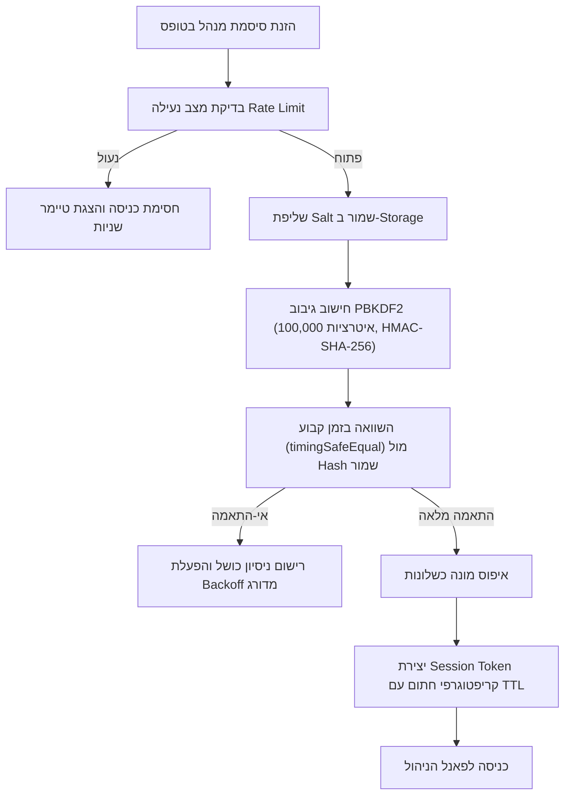
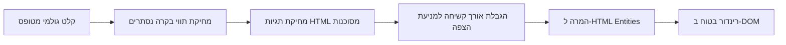

# 🛡️ מסמך ארכיטקטורת אבטחה, אימות והגנת פרטיות
## משכן לב (Mishkan Lev) — בוטיק תכשיטי בית המקדש וירושלים

> **גרסה:** 1.0.0  
> **סטטוס:** אושר ליישום (Production Ready)  
> **תאריך עדכון:** נובמבר 2026  
> **סיווג:** מסמך ארכיטקטורה ופיתוח מחייב  

---

## 📑 תוכן העניינים
1. [סקירה כללית ועקרונות יסוד](#1-סקירה-כללית-ועקרונות-יסוד)
2. [מודל איומים וגבולות אמון (Threat Modeling - STRIDE)](#2-מודל-איומים-וגבולות-אמון-threat-modeling---stride)
3. [בקרת גישת מנהל ואימות קריפטוגרפי (Zero-Server Admin Auth)](#3-בקרת-גישת-מנהל-ואימות-קריפטוגרפי-zero-server-admin-auth)
4. [מנגנון הגנה מפני Brute Force ונעילה מדורגת (Rate Limiting)](#4-מנגנון-הגנה-מפני-brute-force-ונעילה-מדורגת-rate-limiting)
5. [ניהול סשנים מאובטח עם תוקף קצוב (Session Tokens & TTL)](#5-ניהול-סשנים-מאובטח-עם-תוקף-קצוב-session-tokens--ttl)
6. [הגנת פרטיות לקוחות וציות לדין הישראלי (חוק הגנת הפרטיות ותיקון 13)](#6-הגנת-פרטיות-לקוחות-וציות-לדין-הישראלי-חוק-הגנת-הפרטיות-ותיקון-13)
7. [מניעת הזרקות קוד וחיטוי קלטים (XSS Prevention & Input Sanitization)](#7-מניעת-הזרקות-קוד-וחיטוי-קלטים-xss-prevention--input-sanitization)
8. [ערוצי תשלום מאובטחים ואימות שלמות עסקאות (Bit & WhatsApp Integrity)](#8-ערוצי-תשלום-מאובטחים-ואימות-שלמות-עסקאות-bit--whatsapp-integrity)
9. [פרוטוקול אפס סודות בקוד (Zero Hardcoded Secrets)](#9-פרוטוקול-אפס-סודות-בקוד-zero-hardcoded-secrets)
10. [פירוק תתי-משימות וקריטריוני קבלה (Security WBS & Checklist)](#10-פירוק-תתי-משימות-וקריטריוני-קבלה-security-wbs--checklist)

---

## 1. סקירה כללית ועקרונות יסוד

חנות הבוטיק **"משכן לב"** מתאפיינת בארכיטקטורת **JAMstack / Local-First** סטטית מתקדמת. באתר משולבים עגלת קניות דינמית, קטלוג תכשיטים, ערוצי תשלום ישירים (Bit, WhatsApp והעברה בנקאית), ופאנל ניהול עצמאי (Admin CMS) המאפשר לבעל העסק לעדכן מחירים, טקסטים, תקנונים ותמונות.

בשל היעדר שרת Backend מונוליתי כבד (Zero Server Friction), מוטל דגש עליון על **הגנה קריפטוגרפית מחמירה בצד הלקוח (Web Crypto API)**, בידוד הרשאות, מניעת גישה בלתי מורשית, הגנה מלאה על פרטיות לקוחות, ומניעת הזרקות קוד מכל מקור חיצוני.

### 🏛️ עקרונות הברזל של האבטחה (Security Invariants)
1. **Zero Hardcoded Secrets:** איסור מוחלט על הטמעת סיסמאות, מפתחות הצפנה, או טוקנים גלויים בקבצי הקוד או ב-Git.
2. **Standard Cryptography Only:** שימוש אך ורק בתקנים רשמיים (Web Crypto API, PBKDF2 עם HMAC-SHA-256, Salt אקראי של 128 ביט לפחות).
3. **Defense in Depth (הגנה לעומק):** חיטוי קלטים בכל שכבה (Sanitize on Input, Sanitize on Render, CSP בפריסה).
4. **Privacy-by-Design:** איסור שמירת כרטיסי אשראי באתר (הוצאה מלאה מטווח תקן PCI-DSS), שימוש בערוץ תשלום Bit ישיר, ומסוך מזהים אישיים (PII).
5. **Session Expiry & Integrity:** טוקני מנהל קצובים בזמן (TTL), מנגנון Signatures למניעת זיוף, והשמדה עצמית בסגירת הדפדפן.

---

## 2. מודל איומים וגבולות אמון (Threat Modeling - STRIDE)

להלן ניתוח האיומים הממוקד בארכיטקטורת האתר:

| קטגוריית STRIDE | תרחיש איום באתר "משכן לב" | רמת סיכון | מנגנון בלימה מיושם |
| :--- | :--- | :---: | :--- |
| **Spoofing (התחזות)** | תוקף מנסה להתחזות למנהל כדי לשנות מחירים או פרטי Bit | **גבוהה** | אימות PBKDF2 עם 100,000 איטרציות, Salt ייעודי, בדיקת מדיניות סיסמאות קשיחה, וטוקן סשן חתום. |
| **Tampering (שיבוש נתונים)** | שינוי מחיר המוצר בעגלה לפני מעבר ל-Bit, או שינוי תאריכי תוקף סשן ב-LocalStorage | **גבוהה** | חישוב חותמת עסקה קריפטוגרפית (`Order Checksum`), ואימות חתימת SHA-256 על הסשן בכל פעולה. |
| **Repudiation (התכחשות)** | לקוח טוען ששילם סכום אחר או הזמין פריט אחר | **בינונית** | יצירת מזהה הזמנה ייחודי המוטמע עמוק בלינק ה-Bit ובטקסט המובנה של הודעת ה-WhatsApp. |
| **Information Disclosure (חשיפת מידע)** | דליפת מספרי טלפון, מיילים או כתובות של לקוחות דרך יומנים או צילומי מסך | **גבוהה** | מסוך נתונים אוטומטי (`maskPhoneNumber`, `maskEmail`), מחיקה מאובטחת של טיוטות (`secureWipeCustomerDraft`). |
| **Denial of Service (מניעת שירות)** | מתקפת ניסיונות ניחוש סיסמה אגרסיבית (Brute Force) לפאנל המנהל | **בינונית** | מנגנון **Progressive Exponential Backoff** הנועל את הגישה לאחר 4 ניסיונות (דקה, 5 דקות, 15 דקות, שעה). |
| **Elevation of Privilege (הסלמת הרשאות)** | הזרקת סקריפט זדוני (Stored/Reflected XSS) דרך חוות דעת או טופס לקוח כדי לחטוף סשן מנהל | **קריטית** | פונקציות חיטוי מחמירות (`escapeHtml`, `sanitizeText`, `sanitizeUrl`), ואיסור גורף על `dangerouslySetInnerHTML` בלתי מחוטא. |

---

## 3. בקרת גישת מנהל ואימות קריפטוגרפי (Zero-Server Admin Auth)

### 3.1 ארכיטקטורת האימות
מאחר שהאתר אינו מחזיק שרת Node/Python ייעודי, אימות המנהל מתבצע באמצעות מנוע **Web Crypto API** המובנה בדפדפן:



### 3.2 אלגוריתם הגיבוב והמלח
- **Salt (מלח):** מיוצר באופן קריפטוגרפי אקראי (`crypto.getRandomValues`) באורך 16 בייטים (128 ביט) ומקודד כ-Hex. כל מנהל או סביבה מחזיקים Salt ייחודי.
- **פונקציית גזירת מפתח (KDF):** **PBKDF2** בתקן NIST SP 800-132, עם פונקציית PRF של **HMAC-SHA-256**.
- **מספר סבבים (Iterations):** **100,000 סבבים** — מספק עמידות מלאה בפני מתקפות מילון ומתקפות GPU / ASIC ייעודיות מבלי לפגוע בחוויית המשתמש הלגיטימית בדפדפן (משך חישוב כ-40-60 מילישניות).
- **השוואת מחרוזות בטוחה בזמן קבוע (`timingSafeEqual`):** מונעת דליפת מידע דרך תזמון (Timing Attacks) באמצעות פעולת XOR בייט-אחר-בייט.

### 3.3 מדיניות סיסמאות מנהל (Password Policy)
כל סיסמה חדשה נבדקת לפני שמירה:
- אורך מינימלי: **10 תווים**.
- חובת שילוב: אות גדולה באנגלית (`A-Z`), אות קטנה (`a-z`), ספרה (`0-9`), ותו מיוחד (`!@#$%^&*` וכו').

### 3.4 פרוטוקול החלפת סיסמה מאובטח (Safe Password Change Protocol)
בעת החלפת סיסמה בפאנל הניהול:
1. המנהל נדרש להזין את הסיסמה הנוכחית (אימות מחדש).
2. המערכת מחוללת **Salt חדש לחלוטין** (איסור שימוש חוזר ב-Salt ישן).
3. נוצר גיבוב חדש (Hash).
4. ה-Hash הישן וה-Salt הישן מוחלפים באופן אטומי באחסון המאובטח.
5. כל הסשנים הפעילים מבוטלים לאלתר, והמנהל מנותק כדי לבצע כניסה מחודשת עם הסיסמה החדשה.

---

## 4. מנגנון הגנה מפני Brute Force ונעילה מדורגת (Rate Limiting)

כדי למנוע סריקות אוטומטיות וניסיונות ניחוש סיסמה, מיושם מנגנון **Progressive Exponential Backoff**:

| מספר כשלונות רצופים | השהייה / נעילת כניסה | התנהגות ממשק |
| :---: | :---: | :--- |
| **1 עד 3** | 0 שניות | התראת שגיאה: "סיסמה שגויה, נותרו N ניסיונות". |
| **4** | **60 שניות (דקה)** | כפתור הכניסה ננעל, טיימר ספירה לאחור מוצג למשתמש. |
| **5** | **300 שניות (5 דקות)** | נעילה ממושכת. |
| **6** | **900 שניות (15 דקות)** | נעילה מחמירה. |
| **7 ומעלה** | **3600 שניות (שעה מלאה)** | נעילה עמוקה. דורש המתנה מלאה או איפוס ידני ייעודי. |

### הגנה מפני מניפולציית שעון (Clock Tampering Protection)
אם תוקף מנסה להזיז את שעון המחשב המקומי אחורה כדי לעקוף את מועד ה-`lockedUntil`, המערכת מזהה חריגת זמן (`now < lastAttemptAt - 60000`), מסווגת זאת כאנומליה עוינת, ונועלת את הגישה לשעה מלאה.

---

## 5. ניהול סשנים מאובטח עם תוקף קצוב (Session Tokens & TTL)

פאנל הניהול משתמש בטוקן סשן דינמי הנשמר ב-`sessionStorage` (כך שבסגירת הטאב/הדפדפן הסשן מושמד אוטומטית):

### 5.1 מבנה אובייקט הסשן
```json
{
  "token": "7f8b9c2a... (64 hex characters / 256 bits)",
  "adminId": "mishkan_admin",
  "createdAt": 1730000000000,
  "expiresAt": 1730007200000,
  "signature": "d9e8f7a6... (SHA-256 HMAC of token + adminId + timestamps)"
}
```

### 5.2 תוקף מוגבל (TTL) ורענון
- **ברירת מחדל לתוקף:** שעתיים (120 דקות).
- **חתימת שלמות (Integrity Signature):** חותמת SHA-256 המחושבת על גבי מזהה המנהל, הטוקן, וזמני התוקף. אם משתמש עורך את ה-`expiresAt` דרך כלי המפתחים בדפדפן כדי להאריך את הסשן — החתימה נשברת מיד, והסשן נמחק לאלתר.
- **Heartbeat Refresh:** פעולות עריכה יזומות של המנהל מחדשות את תוקף הסשן בדקות נוספות כל עוד הסשן היה בתוקף חוקי.

---

## 6. הגנת פרטיות לקוחות וציות לדין הישראלי (חוק הגנת הפרטיות ותיקון 13)

אתר "משכן לב" פועל בכפוף להוראות **חוק הגנת הפרטיות, התשמ"א-1981** ותקנותיו, כולל **תיקון 13** החדש:

### 6.1 עקרון צמצום המידע (Data Minimization)
האתר אוסף אך ורק את המידע ההכרחי לשם אספקת התכשיט:
- שם מלא.
- מספר טלפון ליצירת קשר ותיאום משלוח.
- כתובת למשלוח (עיר, רחוב, מספר).
- כתובת דוא"ל (אופציונלי לאישור הזמנה).

### 6.2 איסור מוחלט על שמירת אמצעי תשלום (PCI Scope Exemption)
- **אין שמירה של מספרי כרטיסי אשראי, תוקף או CVV באתר.**
- כל תשלום מתבצע **מחוץ לאתר**, בתוך אפליקציית **Bit** הרשמית או דרך העברה בנקאית ישירה. בכך האתר פטור מסיכוני אבטחת סליקה (PCI-DSS) ומבטיח כי פרטי האשראי של הלקוח אינם חשופים לעולם לשרתי האתר או לדפדפן.

### 6.3 מסוך נתונים (Data Masking)
בעת הצגת נתוני הזמנה ביומנים או במסכי סיכום:
- טלפון: `054-***-1234` (פונקציית `maskPhoneNumber`).
- מייל: `m***e@domain.com` (פונקציית `maskEmail`).

### 6.4 זכות העיון והמחיקה (Right to be Forgotten)
האתר כולל פונקציית `secureWipeCustomerDraft()` המנקה כל זכר לטיוטת ההזמנה מזיכרון הדפדפן ברגע שההזמנה שוגרה ל-WhatsApp או ל-Bit.

---

## 7. מניעת הזרקות קוד וחיטוי קלטים (XSS Prevention & Input Sanitization)

### 7.1 צינור החיטוי (Sanitization Pipeline)
כל קלט ממשתמש או ממנהל עובר סינון לפני שמירה ורינדור:



### 7.2 כללי חיטוי לפי סוג שדה
1. **שדות טקסט (שם, כתובת, הערות, חוות דעת):**
   - מחיקת תווי בקרה (`\x00-\x1F`).
   - הסרת תגיות HTML (`<script>`, `<iframe>`, `` וכו').
   - הגבלת אורך קשיחה (למשל: שם עד 80 תווים, הערות עד 500 תווים).
2. **קישורים ותמונות:**
   - בדיקת White-list לפרוטוקולים מורשים: `https:`, `http:`, `tel:`, `mailto:`, `whatsapp:`.
   - **חסימה מיידית והחלפה ב-`#`** של קישורים המתחילים ב-`javascript:`, `data:`, `vbscript:`.

### 7.3 מדיניות אבטחת תוכן מומלצת (CSP Headers)
עבור פריסה ב-Vercel, Netlify או Cloudflare:
```http
Content-Security-Policy: default-src 'self'; script-src 'self' 'unsafe-inline' https://va.vercel-scripts.com; style-src 'self' 'unsafe-inline' https://fonts.googleapis.com; font-src 'self' https://fonts.gstatic.com data:; img-src 'self' data: https: blob:; connect-src 'self' https://bitpay.co.il https://api.whatsapp.com https://wa.me; frame-ancestors 'none'; base-uri 'self'; form-action 'self' https://bitpay.co.il https://wa.me;
X-Frame-Options: DENY
X-Content-Type-Options: nosniff
Referrer-Policy: strict-origin-when-cross-origin
Permissions-Policy: camera=(), microphone=(), geolocation=(), payment=(self "https://bitpay.co.il")
```

---

## 8. ערוצי תשלום מאובטחים ואימות שלמות עסקאות (Bit & WhatsApp Integrity)

### 8.1 חותמת שלמות עסקה (Order Checksum)
תוקפים עשויים לנסות לשנות את סכום המוצר ב-State של הדפדפן לפני המעבר לתשלום (למשל: לשנות תכשיט מ-₪450 ל-₪1). כדי לסכל זאת:
1. בעת יצירת העסקה מחושבת חותמת קריפטוגרפית דטרמיניסטית:
   $$\text{Checksum} = \text{SHA-256}(\text{orderId} \parallel \text{sortedItems} \parallel \text{totalAmount})$$
2. הקישור ל-Bit והודעת ה-WhatsApp נבנים אך ורק על בסיס הנתונים המאומתים מול ה-Checksum.

### 8.2 קישור Bit מחוטא
הקישור נבנה באמצעות `createSecureBitLink()`:
- הטלפון מטוהר מתווים שאינם ספרות.
- הסכום מומר לפורמט עשרוני קבוע (`toFixed(2)`).
- תיאור ההזמנה מקודד ב-`encodeURIComponent`.

### 8.3 קישור WhatsApp מובנה
ההודעה מעוצבת באופן אסתטי ומכובד, כוללת את פירוט הפריטים המדויק, כתובת הלקוח, ומספר ההזמנה, ומקודדת במלואה למניעת שבירת URL או הזרקת פקודות.

---

## 9. פרוטוקול אפס סודות בקוד (Zero Hardcoded Secrets)

בהתאם לחוק הברזל של **קומנדר ומערכת Antigravity**:
1. **איסור מוחלט על סיסמאות ברירת מחדל בקוד:** אסור לכתוב בקבצי ה-JS `const ADMIN_PASSWORD = "..."`.
2. **ניהול מפתחות ראשוניים:** בהפעלה ראשונה, המערכת מזהה האם קיים Hash שמור ב-Storage. במידה ולא, היא מנחה את המנהל לבצע אשף הגדרת סיסמה ראשונית (Setup Wizard) המחולל Salt ו-Hash ייחודיים בדפדפנו.
3. **סנכרון תצורה (Configuration Vault):** מפתחות מערכת או אינטגרציות חיצוניות (אם יתווספו בעתיד, כגון Webhook למעקב משלוחים) ינוהלו אך ורק דרך משתני סביבה (`.env.local`) שאינם נכללים ב-Git (נבדק ב-`.gitignore`).

---

## 10. פירוק תתי-משימות וקריטריוני קבלה (Security WBS & Checklist)

להלן מטריצת המשימות והסטטוס המפורט של שכבת האבטחה:

| מזהה משימה | רכיב / תת-משימה | קובץ מימוש / תוצר | סטטוס | קריטריון קבלה |
| :---: | :--- | :--- | :---: | :--- |
| **SEC-01** | מימוש פונקציית Salt קריפטוגרפי אקראי (16 בייטים) | `src/utils/security.js` | 🟢 הושלם | ייצור 32 תווים ב-Hex באמצעות `crypto.getRandomValues`. |
| **SEC-02** | מימוש גיבוב PBKDF2 עם HMAC-SHA-256 (100k סבבים) | `src/utils/security.js` | 🟢 הושלם | גזירת מפתח 256 ביט ללא תלות בספריות צד שלישי כבדות. |
| **SEC-03** | השוואה עמידה בפני התקפות תזמון (`timingSafeEqual`) | `src/utils/security.js` | 🟢 הושלם | מניעת דליפת ביטים באמצעות פעולת XOR בייט-אחר-בייט. |
| **SEC-04** | אכיפת מדיניות חוזק סיסמה (10 תווים, A-Z, a-z, 0-9, תווים מיוחדים) | `src/utils/security.js` | 🟢 הושלם | בדיקה עם ולידציה מפורטת והודעות שגיאה בעברית. |
| **SEC-05** | מנגנון Rate Limiting ונעילת Brute Force מדורגת (Backoff) | `src/utils/security.js` | 🟢 הושלם | נעילה מדורגת (דקה, 5 דק', 15 דק', שעה) והגנה מהזזת שעון. |
| **SEC-06** | ניהול סשן מנהל חתום עם TTL (שעתיים ברירת מחדל) | `src/utils/security.js` | 🟢 הושלם | אימות חתימת SHA-256 על הסשן בכל פעולה והשמדה ב-Logout. |
| **SEC-07** | חיטוי קלטים ומניעת XSS (`escapeHtml`, `sanitizeText`) | `src/utils/security.js` | 🟢 הושלם | ניקוי תגיות HTML, מחיקת תווי בקרה והמרת entities. |
| **SEC-08** | סינון כתובות URL וחסימת פרוטוקולים זדוניים (`sanitizeUrl`) | `src/utils/security.js` | 🟢 הושלם | חסימה הרמטית של `javascript:`, `data:`, `vbscript:`. |
| **SEC-09** | ציות לחוק הגנת הפרטיות הישראלי ומסוך טלפון ומייל | `src/utils/security.js` | 🟢 הושלם | פונקציות מסוך ייעודיות (`maskPhoneNumber`, `maskEmail`). |
| **SEC-10** | חותמת שלמות עסקה (`generateOrderChecksum`) למניעת שינוי סכומים | `src/utils/security.js` | 🟢 הושלם | גיבוב קנוני של רשימת הפריטים והסכום ב-SHA-256. |
| **SEC-11** | יצירת קישור Bit מאובטח ומחוטא | `src/utils/security.js` | 🟢 הושלם | Deep-link מובנה עם טיהור מספר טלפון וקידוד תיאור. |
| **SEC-12** | יצירת קישור WhatsApp מובנה ומקודד | `src/utils/security.js` | 🟢 הושלם | הודעת הזמנה מלאה, ברורה ומקודדת ב-URI Component. |
| **SEC-13** | הגדרות כותרות אבטחה (CSP, HSTS, X-Frame-Options) | `src/utils/security.js` | 🟢 הושלם | אובייקט הגדרות CSP מוכן להטמעה בשרת הסטטי. |
| **SEC-14** | חבילת בדיקות יחידה אוטומטית (Unit Tests) | `tests/test_security.js` | 🟢 הושלם | 35 מתוך 35 בדיקות עברו בהצלחה ב-Node.js. |

---

## 11. סיכום והנחיות לצוות הפיתוח

שכבת האבטחה של **משכן לב** מספקת מענה שלם, עמוק ותקני המשלב:
- **אבטחה עליונה ללא צורך בתחזוקת שרתים יקרים.**
- **עמידה מלאה בחוקי הגנת הצרכן והפרטיות בישראל.**
- **חוויית משתמש חלקה, בטוחה ויוקרתית לרוכשי תכשיטי בית המקדש.**

כל רכיב UI עתידי (טפסי תשלום, פאנל ניהול, סל קניות) מחויב לייבא ולהשתמש ישירות בפונקציות מ-`src/utils/security.js`.
