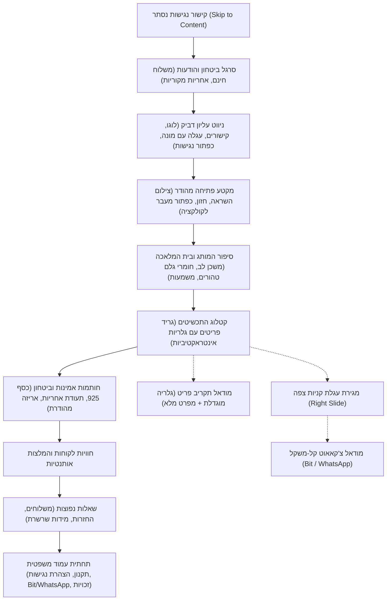

# 🏛️ מפרט חוויית משתמש, שפת עיצוב ונגישות — "משכן לב" (Mishkan Lev)
### מסמך תכנון ארכיטקטוני, מפרט עיצוב בוטיק ירושלמי ותקני נגישות ת"י 5568 / WCAG 2.1 AA

---

## תוכן העניינים
1. [חזון המותג והזהות הוויזואלית (Brand Identity & Aesthetics)](#1-חזון-המותג-והזהות-הוויזואלית)
2. [פלטת צבעים ירושלמית — 100% מצב יום בהיר (Color Palette)](#2-פלטת-צבעים-ירושלמית--100-מצב-יום-בהיר)
3. [מערכת טיפוגרפיה עברית מהודרת (Typography System)](#3-מערכת-טיפוגרפיה-עברית-מהודרת)
4. [ארכיטקטורת מידע ומסעות משתמש (Information Architecture & User Journeys)](#4-ארכיטקטורת-מידע-ומסעות-משתמש)
5. [מפרט גלריית מוצר אינטראקטיבית מסתובבת (Interactive Carousel / Gallery)](#5-מפרט-גלריית-מוצר-אינטראקטיבית-מסתובבת)
6. [עגלת קניות צפה ותהליך צ'קאאוט קל-משקל (Cart Drawer & Bit/WhatsApp Checkout)](#6-עגלת-קניות-צפה-ותהליך-צקאאוט-קל-משקל)
7. [מפרט נגישות מחמיר ת"י 5568 / WCAG 2.1 Level AA](#7-מפרט-נגישות-מחמיר-תי-5568--wcag-21-level-aa)
8. [סרגל נגישות צף — פונקציונליות וארכיטקטורת מצבים](#8-סרגל-נגישות-צף--פונקציונליות-וארכיטקטורת-מצבים)
9. [מיקרו-אינטראקציות, עומקים וחללים נושמים](#9-מיקרו-אינטראקציות-עומקים-וחללים-נושמים)

---

## 1. חזון המותג והזהות הוויזואלית

חנות הבוטיק **"משכן לב"** מתמחה בתכשיטי כסף וזהב ייחודיים הנושאים סמלים עמוקים של בית המקדש, ירושלים, חושן המשפט, מנורת הזהב וסמלי קדושה ומורשת.

### עקרונות ברזל למניעת מראה "AI שבלוני":
* **ללא גרדיאנטים ניאוניים סגולים/כחולים עתידניים**: אף תכשיט אינו מוצג תחת תאורת סייברפאנק.
* **תאורת שמש טבעית ואבן ירושלמית חמה**: הרקעים מעבירים תחושת מגע של נייר קלף טבעי, אבן גיר ירושלמית מלוטשת, וברק זהב עדין של בית מלאכה לצורפות.
* **חללים נושמים (Whitespace & Editorial Layout)**: ריווח נדיב בין הפריטים, קומפוזיציות לא דחוסות, יישור ימני (RTL) הרמוני ומוקפד.
* **חומריות ואמינות**: דגש על צילומי תקריב (Macro) חדים, משקל אמיתי של כסף סטרלינג 925 וזהב 14K/18K, וטקסטורות עדינות המזכירות אבן עתיקה ומשי.

---

## 2. פלטת צבעים ירושלמית — 100% מצב יום בהיר

האתר מבוסס על **100% Light Theme ברירת מחדל בלתי מתפשרת**. כל הרכיבים תוכננו להעניק רוגע, יוקרה וקריאות עליונה בכל תנאי תאורה.

### 🎨 טבלת ה-Tokens הצבעונית:

| קטגוריה | שם Token | ערך HEX | שימוש ותיאור | יחס ניגודיות לרקע (Contrast) |
| :--- | :--- | :--- | :--- | :--- |
| **רקע בסיס** | `--color-bg-base` | `#FDFBF7` | שמנת-אבן רגוע, רקע כללי של האתר | בסיס |
| **רקע משני** | `--color-bg-subtle` | `#FAF8F5` | גוון קלף עדין למקטעי רקע מתחלפים | 1.05:1 |
| **משטח כרטיסיות** | `--color-bg-surface` | `#FFFFFF` | לבן נקי טהור לכרטיסיות מוצר ומודאלים | 1.08:1 |
| **משטח מוגבה** | `--color-bg-elevated`| `#F5F2EB` | רקע כפתורי משנה, תגיות ומסגרות פנימיות | 1.15:1 |
| **זהב ירושלמי ראשי** | `--color-gold-primary`| `#C5A059` | זהב חם ואצילי לכפתורי הנעה, הדגשות וסמלים | 4.8:1 לטקסט מעל לבן |
| **זהב עמוק / לחיצה** | `--color-gold-deep` | `#A6833E` | זהב עמוק למצב Hover/Focus וטקסט זהוב קריא | 5.2:1 (AA עומד במלואו) |
| **זהב עדין / עיטור**| `--color-gold-soft` | `#E8D8B8` | גבולות עדינים, מפרידי קווים וקרוסלות | דקורטיבי |
| **רקע זהב רך** | `--color-gold-tint` | `#FDF9F0` | תגיות מבצע, רקע פריט נבחר | עדין |
| **טקסט ראשי** | `--color-text-main` | `#2D2926` | שחור פחם חם ועמוק (קריאות מקסימלית) | **13.8:1** (AAA תקני) |
| **טקסט משני** | `--color-text-muted`| `#5C554E` | אפור-אבן חם לכתוביות, פירוט ומפרטים | **6.4:1** (AA תקני) |
| **גבולות ומסגרות** | `--color-border-subtle`| `#EBE5DA`| קווים מפרידים דקים ומסגרות כרטיסים | 1.3:1 |
| **גבול מודגש** | `--color-border-accent`| `#C5A059`| מסגרת פוקוס, כרטיס מוצר פעיל | 4.8:1 |
| **ביט (Bit)** | `--color-bit` | `#009E9E` | כחול-טורקיז Bit המוכר, מותאם ניגודיות | **4.9:1** על לבן |
| **וואטסאפ (WhatsApp)**| `--color-whatsapp` | `#1EBE5D` | ירוק וואטסאפ רשמי וקריא | **4.5:1** על לבן |
| **הצלחה / מלאי** | `--color-success` | `#2E7D32` | ירוק יער עמוק (במלאי / משלוח חינם) | **5.5:1** על לבן |
| **שגיאה / אזהרה** | `--color-danger` | `#C62828` | אדום ארגמן עמוק להודעות שגיאה | **5.8:1** על לבן |

---

## 3. מערכת טיפוגרפיה עברית מהודרת

שילוב הרמוני של גופן סריפי קלאסי לכותרות יוקרתיות וגופן סנס-סריפי ישראלי מודרני לקריאות מקסימלית:

* **כותרות ראשיות (Display & Headings)**: `Frank Ruhl Libre`, אלטרנטיבה מקומית: `David Libre` / `Playfair Display`.
  * מעניק תחושת הוד, מסורת, קדושה וירושלמיות עתיקה.
  * משקלים בשימוש: Regular (400), SemiBold (600), Bold (700).
* **גוף טקסט, מפרטים, לחצנים וממשק (Body & UI)**: `Assistant`, אלטרנטיבה: `Heebo`.
  * גופן סנס-סריפי שתוכנן במיוחד לקריאות עברית דיגיטלית צלולה, מרווח אותיות מאוזן ונעים לעין.
  * משקלים בשימוש: Regular (400), Medium (500), SemiBold (600).
* **מספרים ומחירים**: גופן מונו-מאוזן מובלט עם סמל השקל החדש (₪) בגודל פרופורציונלי.

### סולם גדלים (Modular Scale 1.25):
* **Hero Title (h1)**: `clamp(2.25rem, 5vw, 3.5rem)` / מרווח שורה: `1.2`
* **Section Title (h2)**: `clamp(1.75rem, 3.5vw, 2.5rem)` / מרווח שורה: `1.25`
* **Card Title (h3)**: `1.25rem` / מרווח שורה: `1.35`
* **Body Text (p)**: `1.0625rem` (17px) / מרווח שורה: `1.65`
* **Small / Meta**: `0.875rem` (14px) / מרווח שורה: `1.4`
* **Caption / Tags**: `0.75rem` (12px) / מרווח שורה: `1.3`

---

## 4. ארכיטקטורת מידע ומסעות משתמש

האתר בנוי כדף נחיתה ומסחר בוטיקי מלא בעמוד אחד (Single-Page Commerce Architecture) עם מודאלים צפים ומגירת סל קניות מהירה, ללא ריענון עמוד וללא חיכוך.

### מבנה הדף מלמעלה למטה:


---

## 5. מפרט גלריית מוצר אינטראקטיבית מסתובבת

לכל פריט בקטלוג יש גלריה אינטראקטיבית עצמאית המאפשרת התרשמות מלאה מכל זווית:

### דרישות הגלריה לכל כרטיס מוצר:
1. **סט תמונות עשיר (3-4 תמונות לכל פריט)**:
   * **תמונה 1 - פריט מלא (Hero)**: תצלום סטודיו נקי על רקע שמנת-אבן טבעי.
   * **תמונה 2 - צילום אווירה (Lifestyle)**: התכשיט ענוד על הגוף או מונח לצד אלמנט טבעי ירושלמי.
   * **תמונה 3 - תקריב צורפות (Macro Detail)**: התמקדות בעבודת החריטה, השיבוץ והסוגר.
   * **תמונה 4 - אריזת הבוטיק**: קופסת המתנה היוקרתית ותעודת המקוריות.
2. **ממשק ניווט רב-ערוצי**:
   * **חיצי ניווט עדינים (Prev/Next)**: מופיעים בריחוף במחשב וקבועים במובייל, עם כפתורי מגע רחבים (44x44px מינימום).
   * **נקודות אינדיקציה (Dots Indicator)**: מציגות את התמונה הפעילה ומאפשרות קפיצה בלחיצה.
   * **תמונות ממוזערות (Thumbnails)** במודאל התקריב המורחב.
   * **תמיכה במחוות מגע (Swipe)** במסכי מגע.
   * **שליטת מקלדת**: תמיכה במקשי חיצים (ימין/שמאל) בעת פוקוס על הגלריה.
3. **יחס תמונה (Aspect Ratio)**: ריבועי מושלם `1:1` או פורטרט מעודן `4:5` למניעת קפיצות גובה (Layout Shift - CLS 0).

---

## 6. עגלת קניות צפה ותהליך צ'קאאוט קל-משקל

תהליך הרכישה מותאם ישירות לרוכשים בישראל ללא סרבול, ללא צורך בהרשמה או סיסמאות:

### א. מגירת עגלת הקניות (Floating Cart Drawer):
* מחליקה ברכות מימין עם שכבת רקע כהה שקופה (Backdrop blur).
* הצגת פריטים, תמונה ממוזערת, כמות (+ / -), מחיר ומחיקה.
* מד התקדמות למשלוח חינם (למשל: "הוסף עוד ₪80 וקבל משלוח מהיר חינם!").
* סיכום כספי ברור כולל מע"מ ומשלוח.
* כפתור בולט: **"מעבר לתשלום מהיר"**.

### ב. מודאל צ'קאאוט ב-Bit ו-WhatsApp (Zero-Friction Checkout):
1. **טופס פרטי משלוח תמציתי**:
   * שם מלא, טלפון, עיר וכתובת למשלוח, הערה להזמנה (אופציונלי).
2. **אפשרויות תשלום ברורות**:
   * **אפשרות א': תשלום מיידי ב-Bit**:
     * הצגת מספר הנייד של החנות בצורה בולטת (`05X-XXXXXXX`).
     * כפתור **"העתק מספר ל-Bit"** בלחיצה אחת עם הודעת אישור ("המספר הועתק!").
     * קישור ישיר לפתיחת אפליקציית Bit במכשירים תומכים.
     * הנחיה פשוטה: "שלחו את הסכום המדויק ב-Bit וציינו את שמכם בהערת ההעברה".
   * **אפשרות ב': שליחת הזמנה לוואטסאפ של בית המלאכה**:
     * כפתור ירוק מהודר **"שלח הזמנה בוואטסאפ"** שמייצר הודעה מנוסחת מראש:
       ```text
       שלום משכן לב! 🌿
       אשמח לבצע הזמנה:
       • פריט: שרשרת מנורת המקדש (כסף 925) - כמות: 1 - ₪340
       • סה"כ להזמנה: ₪340
       
       פרטי משלוח:
       • שם: [שם הלקוח]
       • טלפון: [טלפון]
       • כתובת: [כתובת מלאה]
       • אמצעי תשלום מבוקש: Bit / העברה
       ```
     * כפתור **"העתק הודעה"** למקרה שוואטסאפ ווב אינו נפתח ישירות.

---

## 7. מפרט נגישות מחמיר ת"י 5568 / WCAG 2.1 Level AA

האתר מחויב לתקנות שוויון זכויות לאנשים עם מוגבלות (התאמות נגישות לשירות), תשע"ג-2013, תקן ישראלי ת"י 5568 ברמה AA, והנחיות WCAG 2.1 הבינלאומיות.

### כללי ברזל מיושמים:
1. **דילוג לתוכן המרכזי (Skip to Content)**:
   * קישור בראש הדף שמופיע בלחיצת Tab ראשונה ומאפשר מעבר ישיר לתוכן ללא צורך במעבר על כל קישורי התפריט.
2. **ניווט מקלדת מלא (Keyboard Navigability)**:
   * כל רכיב אינטראקטיבי (קישור, כפתור, שדה טקסט, גלריה, מודאל) נגיש במלואו באמצעות מקש `Tab`, `Shift+Tab`, `Enter`, `Space`, וחיצים.
   * **מחוון פוקוס ברור ובולט**: טבעת כפולה מנוגדת (`outline: 3px solid #C5A059; outline-offset: 3px; box-shadow: 0 0 0 5px rgba(197, 160, 89, 0.25)`).
   * **נעילת פוקוס (Focus Trap)**: בעת פתיחת מודאל או מגירת עגלה, הפוקוס ננעל בתוכם ולא "בורח" לרקע.
   * **סגירה ב-ESC**: לחיצה על מקש Escape סוגרת כל מודאל, מגירה או תפריט פתוח ומחזירה את הפוקוס לכפתור שפתח אותם.
3. **סמנטיקה וקוראי מסך (Screen Readers & ARIA)**:
   * שימוש בתגיות HTML5 סמנטיות: `<header>`, `<nav>`, `<main>`, `<section>`, `<article>`, `<aside>`, `<footer>`.
   * לכל התמונות טקסט חלופי (`alt`) עשיר בעברית המתאר את התכשיט, החומר והמשמעות.
   * תגיות `aria-expanded`, `aria-controls`, `aria-label`, `aria-live="polite"` עבור עדכוני עגלה והודעות מערכת.
4. **עצירת הבהובים ותנועה מופחתת (`prefers-reduced-motion`)**:
   * כיבוד מלא של הגדרת המערכת של המשתמש.
   * אפשרות לביטול יזום של אנימציות ומעברים דרך סרגל הנגישות.

---

## 8. סרגל נגישות צף — פונקציונליות וארכיטקטורת מצבים

סרגל הנגישות ממוקם בפינה השמאלית-תחתונה של המסך (אינו מסתיר את כפתור הוואטסאפ בפינה הימנית) ומכיל תפריט מודולרי:

### כפתורי הסרגל:
1. **גודל טקסט (3 רמות)**:
   * רגיל (100%)
   * מוגדל (115%)
   * גדול במיוחד (130%)
2. **ניגודיות גבוהה (High Contrast Mode)**:
   * רקע לבן טהור, טקסט שחור מוחלט (`#000000`), מסגרות שחורות עבות וזהב מודגש.
3. **ניגודיות הפוכה (Inverted / Dark Accessibility Mode)**:
   * מספק מענה למשתמשים לקויי ראייה הזקוקים לרקע כהה עם ניגודיות גבוהה.
4. **מונוכרום (גווני אפור)**:
   * מסיר את כל הצבעים ומציג את האתר בגווני אפור טהורים עבור עיוורי צבעים.
5. **גופן קריא במיוחד (Dyslexia Friendly Font)**:
   * החלפת כל הגופנים לגופן סנס-סריפי פשוט, ישר, עם רווח אותיות מוגדל.
6. **הדגשת קישורים וכפתורים**:
   * הוספת קו תחתון עבה ומסגרת מודגשת לכל אלמנט לחיץ.
7. **עצירת אנימציות ומעברים**:
   * ביטול כל המעברים החלקים, הרפרופים והקרוסלות המסתובבות.
8. **איפוס הגדרות (Reset All)**:
   * החזרת האתר להגדרות ברירת המחדל היפהפיות בלחיצה אחת.
* **שמירה מקומית (Persistence)**: כל הגדרות הנגישות נשמרות ב-`localStorage` כך שהן נשמרות בין ביקורים.

---

## 9. מיקרו-אינטראקציות, עומקים וחללים נושמים

* **צללים ועומק (Elevation Tokens)**: צללים רכים ועדינים בגווני אבן טבעית וחום-זהב רך (ללא שחור גס):
  * `shadow-sm`: `0 2px 8px -2px rgba(45, 41, 38, 0.05)`
  * `shadow-md`: `0 6px 20px -4px rgba(45, 41, 38, 0.08), 0 2px 6px -1px rgba(197, 160, 89, 0.04)`
  * `shadow-lg`: `0 16px 36px -8px rgba(45, 41, 38, 0.12), 0 4px 12px -2px rgba(197, 160, 89, 0.08)`
  * `shadow-floating`: `0 24px 48px -12px rgba(45, 41, 38, 0.16)`
* **רדיוס פינות (Border Radius)**:
  * כרטיסים ומודאלים: `12px` (מעודן, לא עגלגל מוגזם)
  * כפתורים: `8px`
  * תגיות וגלולות: `9999px` (Pill)
* **מיקרו-אינטראקציה בהוספה לסל**:
  * שינוי זמני של כפתור ההוספה לסימון V ירוק עם הודעה "נוסף בהצלחה!", יחד עם פולס עדין על מונה הפריטים בעגלה.

---

מסמך זה מאושר כמפת הדרכים המחייבת לכל שלבי הפיתוח, העיצוב והבדיקות של חנות הבוטיק "משכן לב".
